
<a href="README.md">Português</a> · <b>English</b>

<picture><source media="(max-width: 600px)" srcset="./assets/perfil/hero-mobile-en.svg" />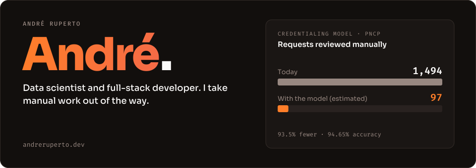</picture>

  
  
  
  

### About me

<picture><source media="(max-width: 600px)" srcset="./assets/perfil/numeros-mobile-en.svg" />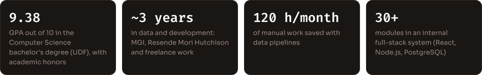</picture>

- **Bachelor's degree in Computer Science** from **Centro Universitário UDF**, Brazil (2022–2025) — academic honors and a top grade on a final thesis in Data Science and Machine Learning
- **Open to roles** in data (analysis and engineering) and in building data-driven systems
- **Available for freelance work** on websites, web systems, dashboards and automation — [andreruperto.dev](https://www.andreruperto.dev)

---

### Experience

<picture><source media="(max-width: 600px)" srcset="./assets/perfil/experiencia-mobile-en.svg" />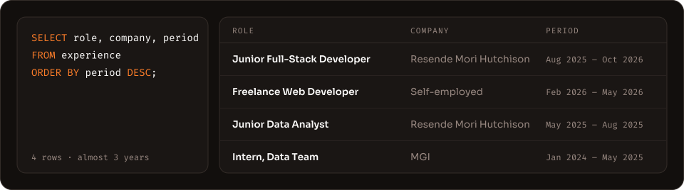</picture>

- **Junior Full-Stack Developer** · Resende Mori Hutchison — internal system with more than 30 modules (React 18 + TypeScript, Node.js + Express, PostgreSQL, Airflow)
- **Freelance Web Developer** · Self-employed — custom websites and systems, from planning to deployment
- **Junior Data Analyst** · Resende Mori Hutchison — pipelines in Python/pandas, dashboards in Power BI and Qlik
- **Intern, Data Team (COTIN)** · Brazil's Ministry of Management and Innovation (MGI) — scrapers, Power BI, documentation of the Compras.gov.br API

---

### Featured projects

#### 01 / Turnos: 2026 Brazilian elections

<a href="https://1e2turnos.up.railway.app/">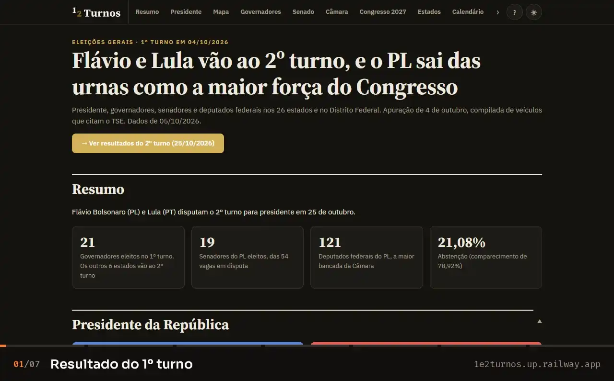</a>

Data journalism portal covering both rounds of Brazil's 2026 general elections, with a state cartogram, seat charts for the 2027 Congress and 596 candidate profiles.

- **Features:** interactive map by state and municipality, cartogram, sortable tables, seat charts by party and spectrum, analysis between rounds, light and dark themes
- **Stack:** HTML, CSS and JavaScript on the site; Python for data collection and processing
- **Status:** live, with both rounds published (site in Portuguese)

[Site](https://1e2turnos.up.railway.app/) · [Code](https://github.com/AndreRuperto/turnos)

#### 02 / Triagegeist

<a href="https://triagegeist-kaggle.up.railway.app/">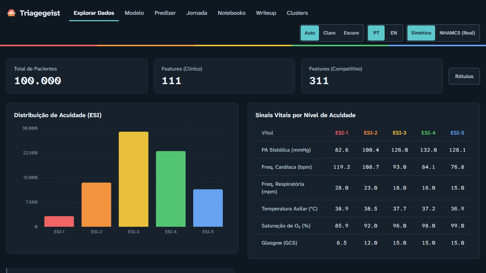</a>

AI for emergency-room triage that classifies patients from ESI 1 to 5 and explains each prediction with SHAP. During the analysis I identified data leakage in the Kaggle challenge dataset.

- **Features:** data exploration, interactive prediction, notebooks and write-up, in Portuguese and English
- **Data:** 100,000 synthetic patients from the challenge and the real NHAMCS dataset
- **Stack:** Python, FastAPI, scikit-learn, LightGBM, XGBoost, SHAP and UMAP
- **Status:** site live; code in a private repository

[Site](https://triagegeist-kaggle.up.railway.app/) · [Kaggle challenge](https://www.kaggle.com/competitions/triagegeist/overview)

#### 03 / Good Cities

<a href="https://good-cities.up.railway.app/">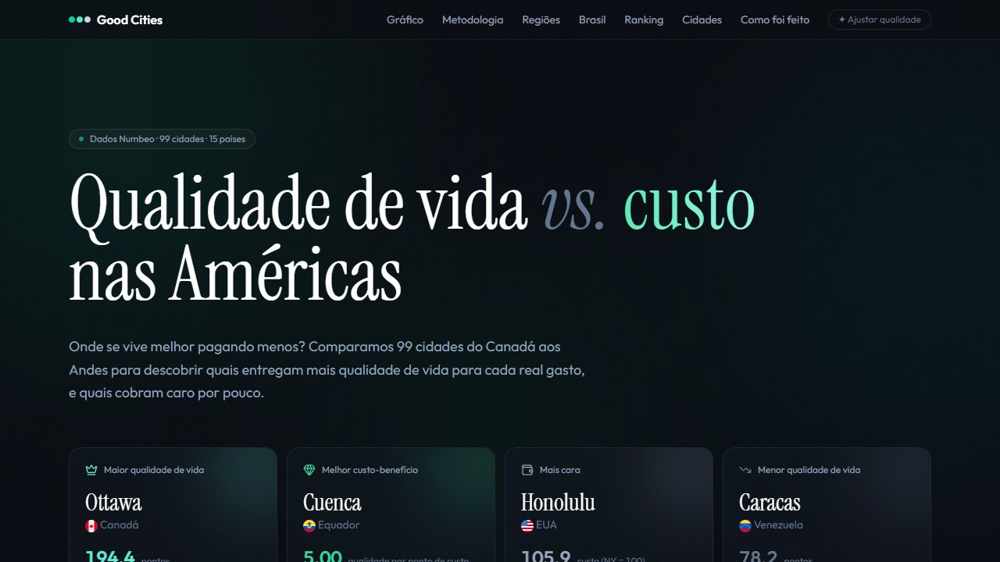</a>

Compares quality of life and cost across 99 cities in 15 countries of the Americas, from Canada to the Andes, to show where you live better for less.

- **Features:** quality-versus-cost chart, ranking, views by region and for Brazil, a page per city and an open methodology
- **Stack:** React, TypeScript, Vite, Tailwind CSS, Leaflet and Framer Motion
- **Status:** site live (in Portuguese); code in a private repository

[Site](https://good-cities.up.railway.app/)

#### 04 / DataBola

<a href="https://databola.up.railway.app/">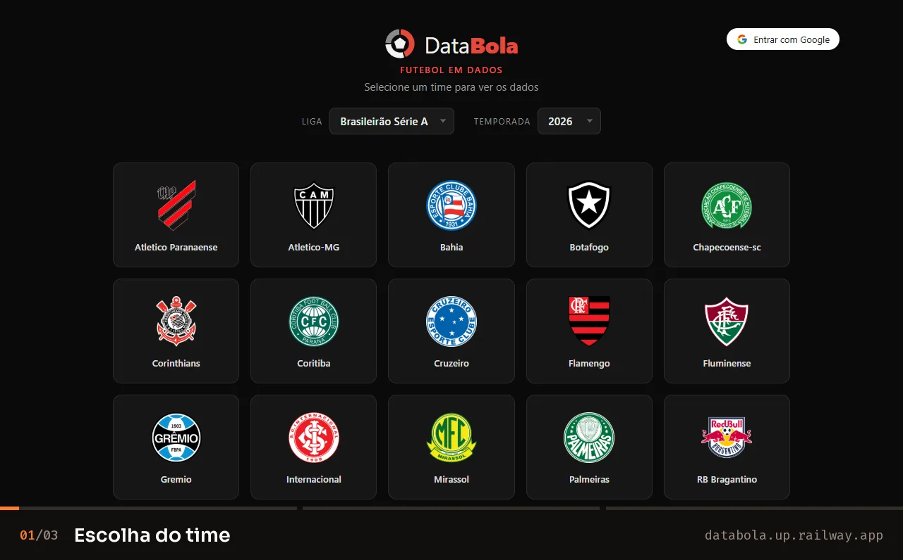</a>

Data dashboard for Brazil's top football league, with automated collection, a dashboard per team, an interactive pitch map and a live mode.

- **Features:** team dashboard (overview, goals by minute, top scorers, line-ups, upcoming matches), pitch map with event replay, live mode and a PDF of the day's matches
- **Data:** automatic collection through API-Football, stored in PostgreSQL
- **Stack:** Python, FastAPI, PostgreSQL and Google sign-in
- **Status:** site live (in Portuguese); code in a private repository

[Site](https://databola.up.railway.app/)

#### 05 / A Carta

<a href="https://melhores-restaurantes.up.railway.app/">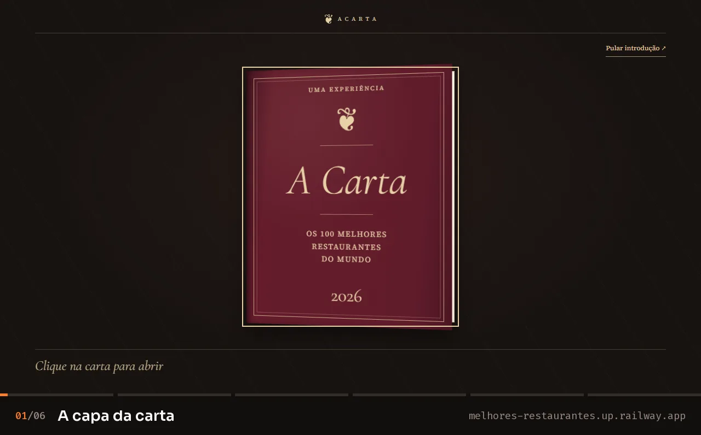</a>

The world's 100 best restaurants in 2026, according to The 50 Best, presented as a menu that opens: map, ranking, views by continent, country and Brazil, and a page for each restaurant.

- **Features:** animated menu-style opening, interactive map, searchable and filterable list, and 100 restaurant profiles
- **Stack:** React, Vite, Tailwind CSS, D3 and TopoJSON
- **Quality:** tests with Playwright and axe, and Lighthouse above 90 on the main pages
- **Status:** live (in Portuguese)

[Site](https://melhores-restaurantes.up.railway.app/) · [Code](https://github.com/AndreRuperto/melhores-restaurantes)

#### 06 / Cronomapa

<a href="https://cronomapa.up.railway.app/">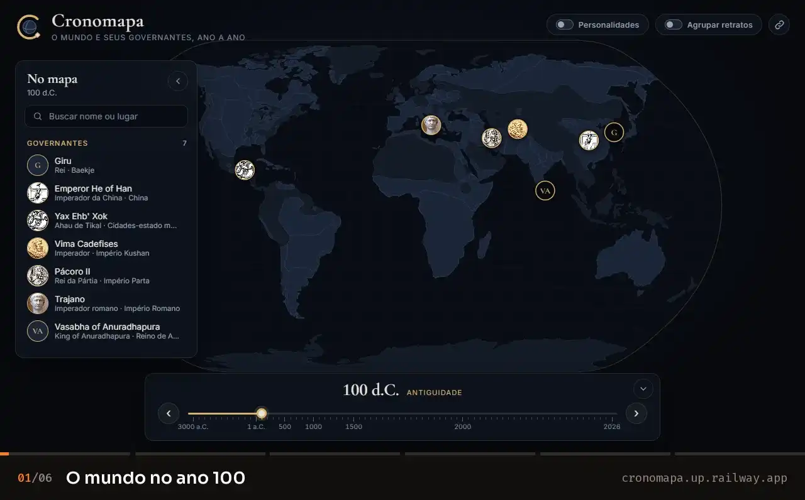</a>

Interactive map showing how the world's borders changed since 3000 BC and who ruled each territory in each period.

- **Features:** timeline from 3000 BC to 2026, ruler portraits on the map, searchable list, a page for each ruler and a layer of notable figures (philosophy, literature, art and science)
- **Data:** borders from historical-basemaps and rulers from Wikidata
- **Stack:** JavaScript, D3 and Vite
- **Status:** site live (in Portuguese); code in a private repository

[Site](https://cronomapa.up.railway.app/)

#### More projects

<a href="https://www.andreruperto.dev/#projects">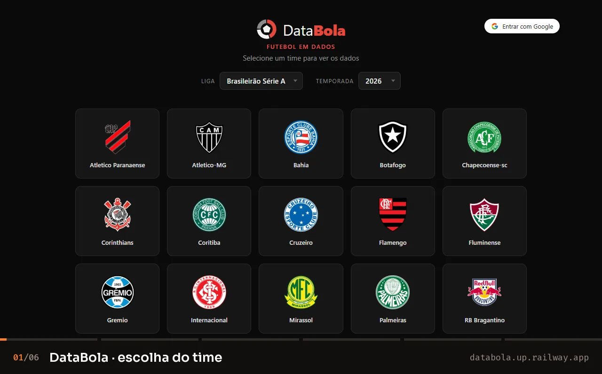</a>

<a href="https://genetica-na-gestacao.up.railway.app/"><picture><source media="(max-width: 600px)" srcset="./assets/perfil/projeto-genetica-mobile-en.svg" />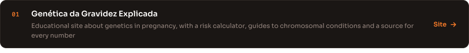</picture></a>
<picture><source media="(max-width: 600px)" srcset="./assets/perfil/projeto-pncp-mobile-en.svg" />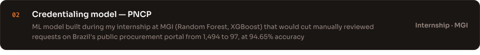</picture>
<a href="https://www.youtube.com/watch?v=234EGymqotI"><picture><source media="(max-width: 600px)" srcset="./assets/perfil/projeto-alice-mobile-en.svg" />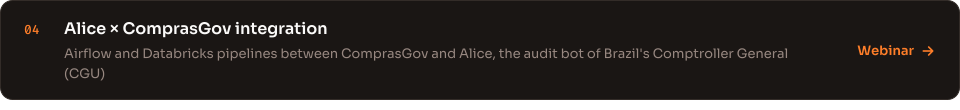</picture></a>
<a href="https://github.com/AndreRuperto/svg-pacman-contributions"><picture><source media="(max-width: 600px)" srcset="./assets/perfil/projeto-pacman-mobile-en.svg" />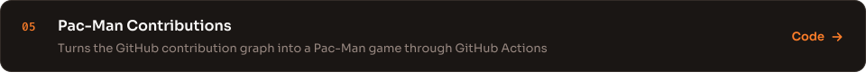</picture></a>
<a href="https://github.com/AndreRuperto/whatsapp_gastos_ai"><picture><source media="(max-width: 600px)" srcset="./assets/perfil/projeto-whatsapp-mobile-en.svg" />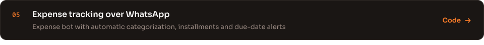</picture></a>

<a href="https://www.andreruperto.dev/#projects">See all projects in the portfolio →</a>

---

### Technical skills

<picture><source media="(max-width: 600px)" srcset="./assets/perfil/skills-mobile-en.svg" /></picture>

---

<!-- STATS:START -->
### Statistics

  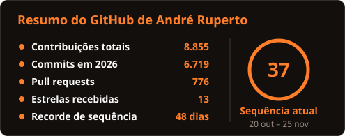
  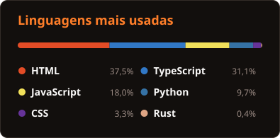

  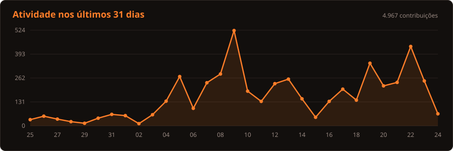

<!-- STATS:END -->

  

