
<b>Português</b> · <a href="README.en.md">English</a>

<picture><source media="(max-width: 600px)" srcset="./assets/perfil/hero-mobile.svg" />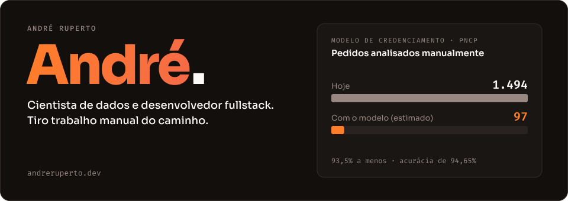</picture>

  
  
  
  

### Sobre mim

<picture><source media="(max-width: 600px)" srcset="./assets/perfil/numeros-mobile.svg" /></picture>

- **Bacharel em Ciência da Computação** pelo **Centro Universitário UDF** (2022–2025) — Láurea Acadêmica e nota 10 no TCC em Ciência de Dados e Machine Learning
- **Aberto a vagas** de dados (análise e engenharia) e de desenvolvimento de sistemas orientados a dados
- **Disponível para freelas** de sites, sistemas web, dashboards e automação — [andreruperto.dev](https://www.andreruperto.dev)

---

### Experiência

<picture><source media="(max-width: 600px)" srcset="./assets/perfil/experiencia-mobile.svg" />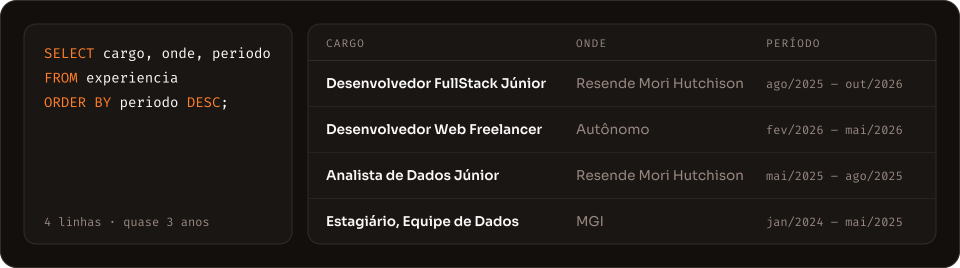</picture>

- **Desenvolvedor FullStack Júnior** · Resende Mori Hutchison — sistema interno com mais de 30 módulos (React 18 + TypeScript, Node.js + Express, PostgreSQL, Airflow)
- **Desenvolvedor Web Freelancer** · Autônomo — sites e sistemas sob medida, do planejamento ao deploy
- **Analista de Dados Júnior** · Resende Mori Hutchison — pipelines em Python/pandas, dashboards em Power BI e Qlik
- **Estagiário, Equipe de Dados (COTIN)** · Ministério da Gestão e da Inovação (MGI) — scrapers, Power BI, documentação da API do Compras.gov.br

---

### Projetos em destaque

#### 01 / Turnos: Eleições 2026

<a href="https://1e2turnos.up.railway.app/">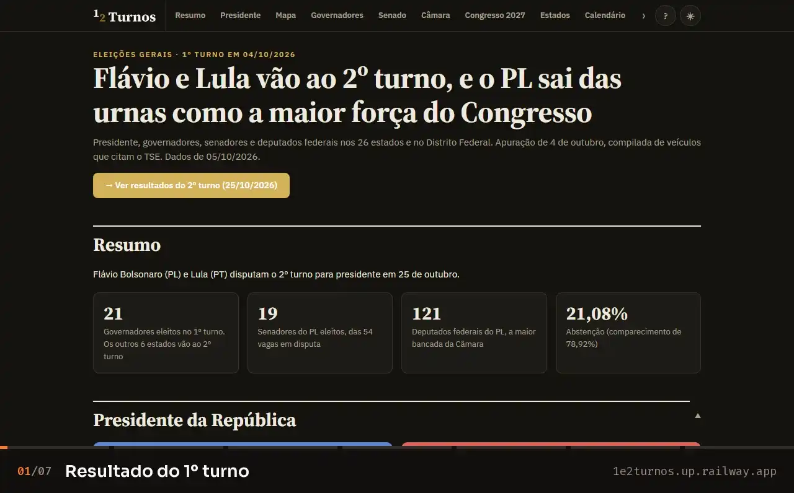</a>

Portal de jornalismo de dados sobre os dois turnos das eleições gerais de 2026, com cartograma por estado, hemiciclos do Congresso de 2027 e 596 perfis de candidatos.

- **Recursos:** mapa interativo por estado e município, cartograma, tabelas ordenáveis, hemiciclos por partido e espectro, análise entre os turnos, tema claro e escuro
- **Stack:** HTML, CSS e JavaScript no site; Python na coleta e no tratamento dos dados
- **Estado:** no ar, com os dois turnos publicados

[Site](https://1e2turnos.up.railway.app/) · [Código](https://github.com/AndreRuperto/turnos)

#### 02 / Triagegeist

IA para triagem em pronto-socorro, que classifica o paciente de ESI 1 a 5 e explica cada previsão com SHAP. Na análise, identifiquei vazamento de dados na base do desafio Kaggle.

- **Recursos:** exploração dos dados, previsão interativa, notebooks e relatório, em português e inglês
- **Dados:** 100 mil pacientes sintéticos do desafio e a base real NHAMCS
- **Stack:** Python, FastAPI, scikit-learn, LightGBM, XGBoost, SHAP e UMAP
- **Estado:** site no ar; código em repositório privado

[Site](https://triagegeist-kaggle.up.railway.app/) · [Desafio no Kaggle](https://www.kaggle.com/competitions/triagegeist/overview)

#### 03 / Good Cities

<a href="https://good-cities.up.railway.app/">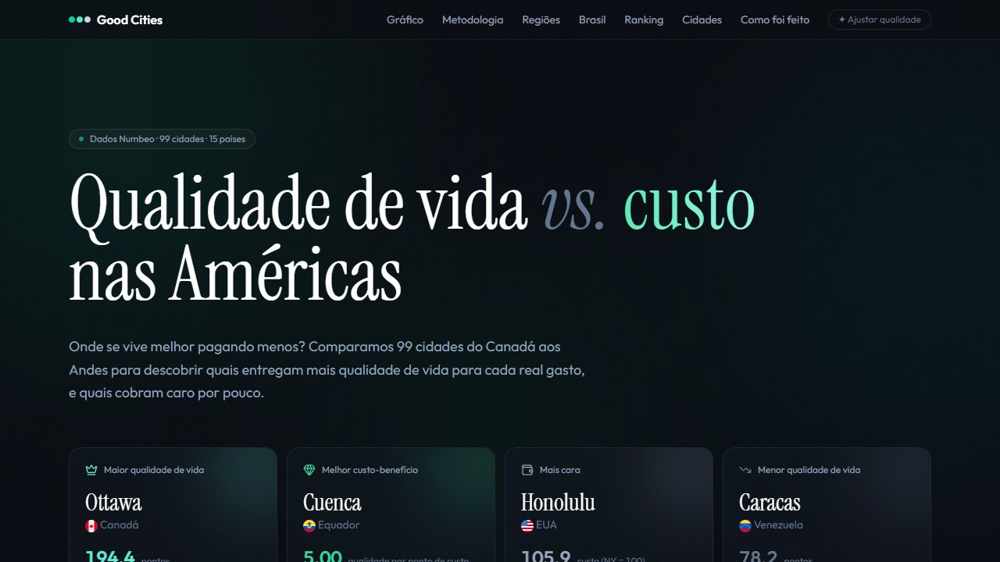</a>

Compara qualidade de vida e custo em 99 cidades de 15 países das Américas, do Canadá aos Andes, para mostrar onde se vive melhor pagando menos.

- **Recursos:** gráfico de qualidade por custo, ranking, recortes por região e por Brasil, página por cidade e metodologia aberta
- **Stack:** React, TypeScript, Vite, Tailwind CSS, Leaflet e Framer Motion
- **Estado:** site no ar; código em repositório privado

[Site](https://good-cities.up.railway.app/)

#### 04 / DataBola

<a href="https://databola.up.railway.app/">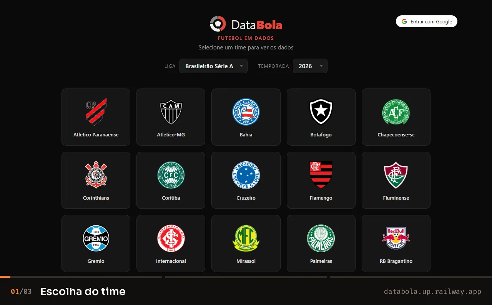</a>

Dashboard de dados do Brasileirão Série A, com coleta automatizada, painel por time, mapa de campo interativo e modo ao vivo.

- **Recursos:** painel por time (visão geral, gols por minuto, artilheiros, escalações, próximos jogos), mapa de campo com replay dos eventos, modo ao vivo e PDF dos jogos do dia
- **Dados:** coleta automática via API-Football, com armazenamento em PostgreSQL
- **Stack:** Python, FastAPI, PostgreSQL e login com Google
- **Estado:** site no ar; código em repositório privado

[Site](https://databola.up.railway.app/)

#### 05 / A Carta

<a href="https://melhores-restaurantes.up.railway.app/">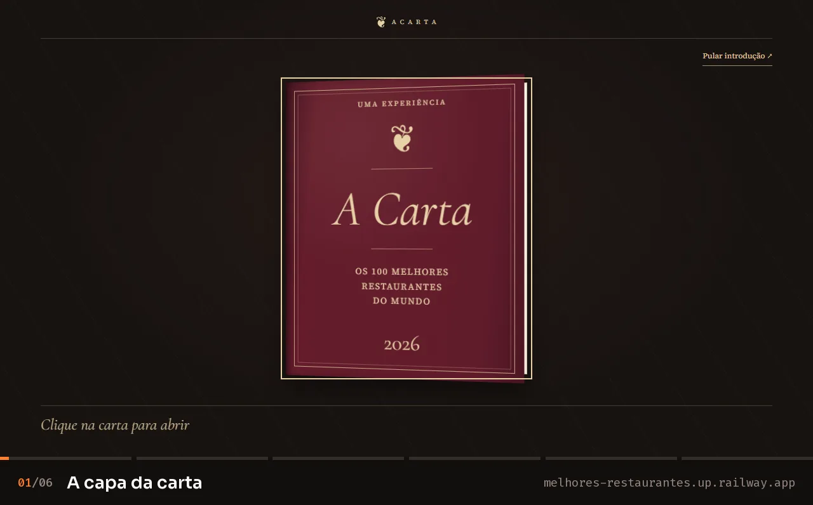</a>

Os 100 melhores restaurantes do mundo em 2026, segundo o The 50 Best, apresentados como uma carta que se abre: mapa, ranking, recortes por continente, país e Brasil, e uma página por restaurante.

- **Recursos:** abertura animada em forma de carta, mapa interativo, lista com busca e filtros, e 100 perfis de restaurante
- **Stack:** React, Vite, Tailwind CSS, D3 e TopoJSON
- **Qualidade:** testes com Playwright e axe, e Lighthouse acima de 90 nas páginas principais
- **Estado:** no ar

[Site](https://melhores-restaurantes.up.railway.app/) · [Código](https://github.com/AndreRuperto/melhores-restaurantes)

#### 06 / Cronomapa

<a href="https://cronomapa.up.railway.app/">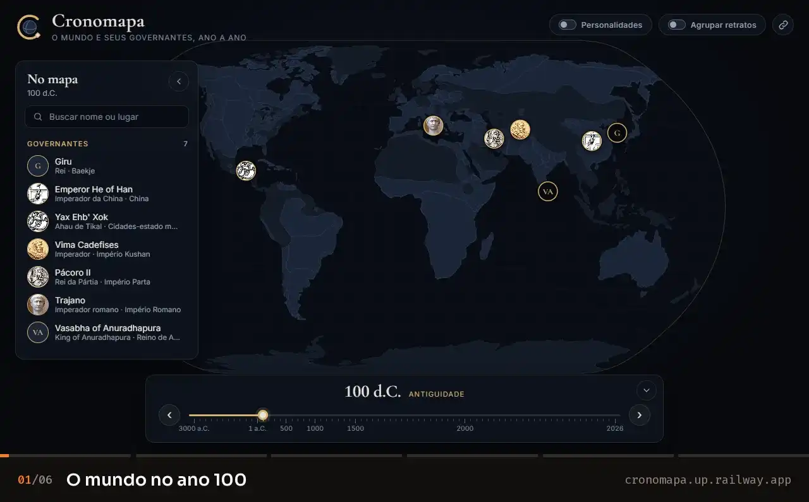</a>

Mapa interativo que mostra como as fronteiras do mundo mudaram desde 3000 a.C. e quem governava cada território em cada época.

- **Recursos:** régua do tempo de 3000 a.C. a 2026, retratos dos governantes no mapa, lista com busca, página de cada governante e camada de personalidades (filosofia, literatura, arte e ciência)
- **Dados:** fronteiras do historical-basemaps e governantes do Wikidata
- **Stack:** JavaScript, D3 e Vite
- **Estado:** site no ar; código em repositório privado

[Site](https://cronomapa.up.railway.app/)

#### Mais projetos

<a href="https://www.andreruperto.dev/#projects">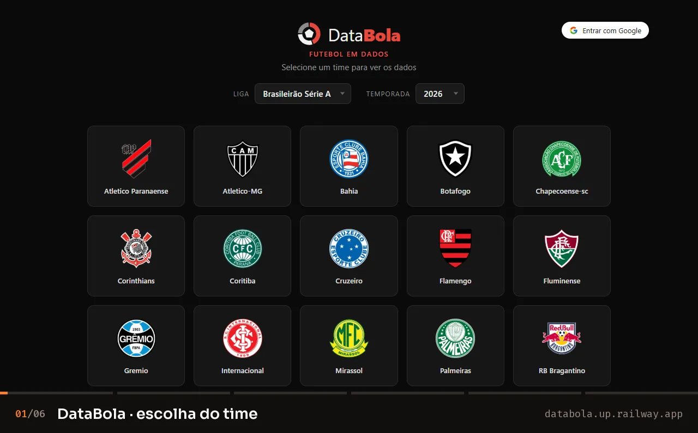</a>

<a href="https://genetica-na-gestacao.up.railway.app/"><picture><source media="(max-width: 600px)" srcset="./assets/perfil/projeto-genetica-mobile.svg" />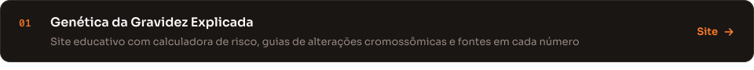</picture></a>
<picture><source media="(max-width: 600px)" srcset="./assets/perfil/projeto-pncp-mobile.svg" />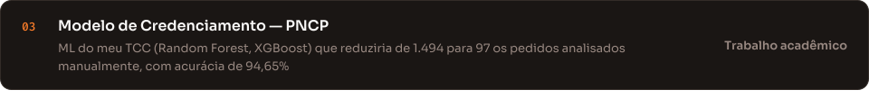</picture>
<a href="https://www.youtube.com/watch?v=234EGymqotI"><picture><source media="(max-width: 600px)" srcset="./assets/perfil/projeto-alice-mobile.svg" />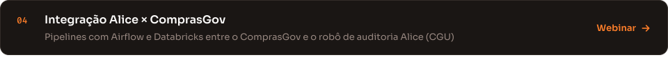</picture></a>
<a href="https://github.com/AndreRuperto/svg-pacman-contributions"><picture><source media="(max-width: 600px)" srcset="./assets/perfil/projeto-pacman-mobile.svg" />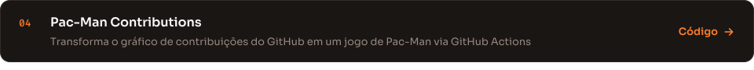</picture></a>
<a href="https://github.com/AndreRuperto/whatsapp_gastos_ai"><picture><source media="(max-width: 600px)" srcset="./assets/perfil/projeto-whatsapp-mobile.svg" />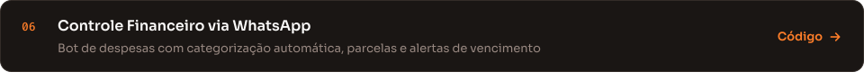</picture></a>
<a href="https://cobraol.up.railway.app"><picture><source media="(max-width: 600px)" srcset="./assets/perfil/projeto-cobraol-mobile.svg" />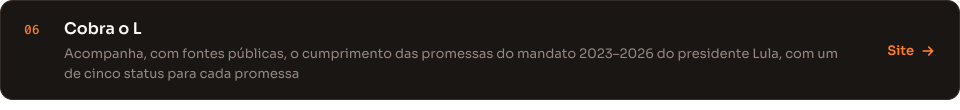</picture></a>
<a href="https://2turno.up.railway.app/"><picture><source media="(max-width: 600px)" srcset="./assets/perfil/projeto-2turno-mobile.svg" />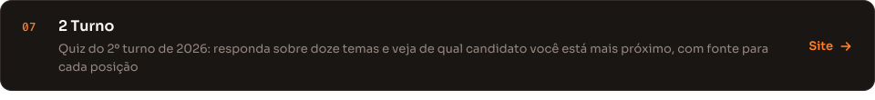</picture></a>
<a href="https://github.com/AndreRuperto/mercado-eleicoes"><picture><source media="(max-width: 600px)" srcset="./assets/perfil/projeto-mercado-mobile.svg" />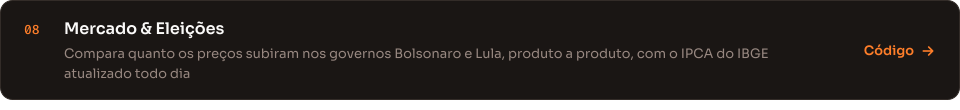</picture></a>
<a href="https://github.com/AndreRuperto/Capi3D"><picture><source media="(max-width: 600px)" srcset="./assets/perfil/projeto-capi3d-mobile.svg" />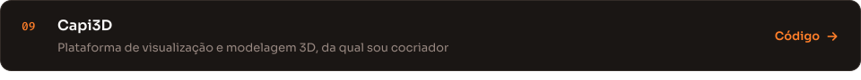</picture></a>
<a href="https://mangueiraepeixoto.com.br"><picture><source media="(max-width: 600px)" srcset="./assets/perfil/projeto-mangueira-mobile.svg" />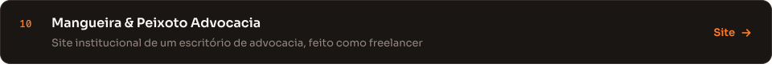</picture></a>
<a href="https://bluemais.up.railway.app"><picture><source media="(max-width: 600px)" srcset="./assets/perfil/projeto-bluemais-mobile.svg" />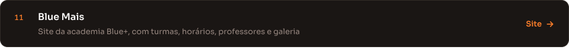</picture></a>
<a href="https://documenter.getpostman.com/view/13166820/2sA3XJjPpR"><picture><source media="(max-width: 600px)" srcset="./assets/perfil/projeto-apicompras-mobile.svg" />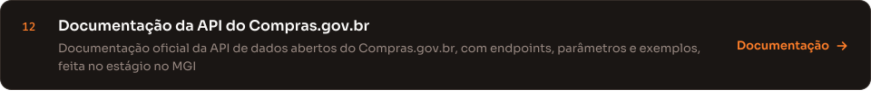</picture></a>
<a href="https://simulador-sistemas-autenticacao.vercel.app"><picture><source media="(max-width: 600px)" srcset="./assets/perfil/projeto-simulador-mobile.svg" />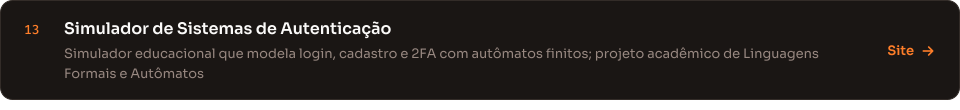</picture></a>
<a href="https://github.com/AndreRuperto/leis-rag"><picture><source media="(max-width: 600px)" srcset="./assets/perfil/projeto-leisrag-mobile.svg" />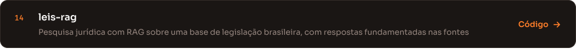</picture></a>

<a href="https://www.andreruperto.dev/#projects">Ver todos os projetos no portfólio →</a>

---

### Skills técnicas

<picture><source media="(max-width: 600px)" srcset="./assets/perfil/skills-mobile.svg" /></picture>

---

<!-- STATS:START -->
### Estatísticas

  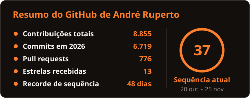
  

  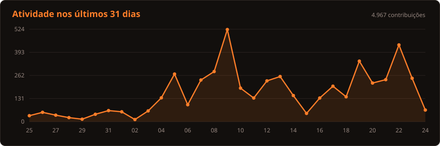

<!-- STATS:END -->

  

