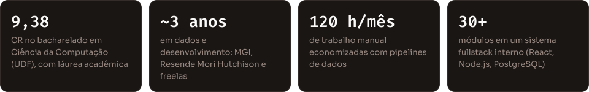
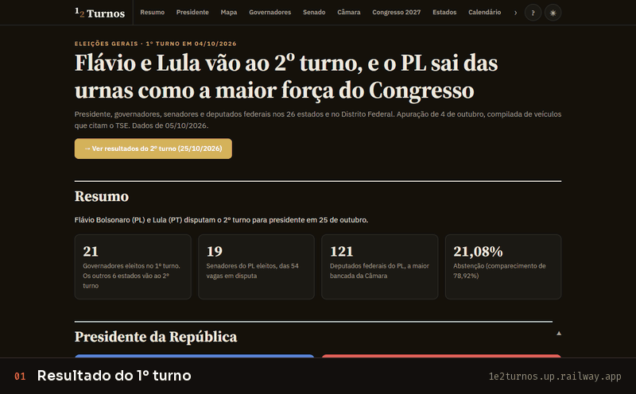
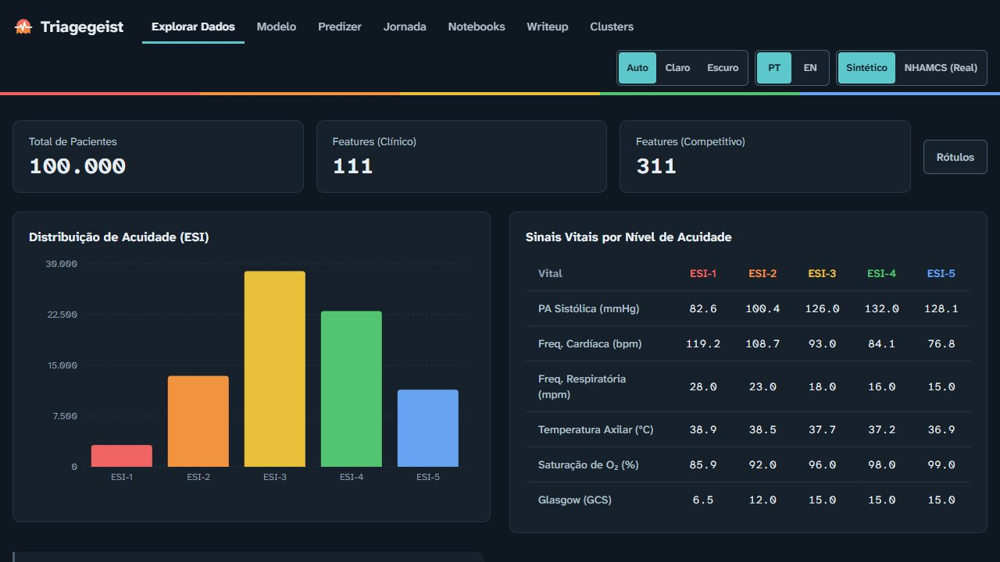
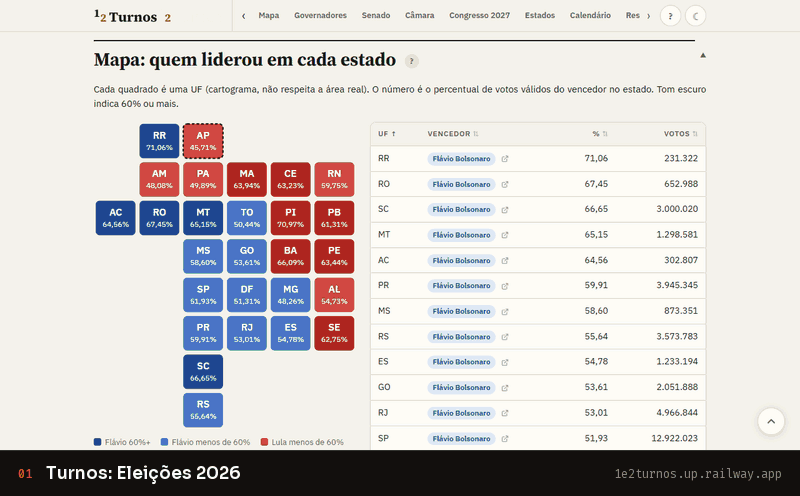
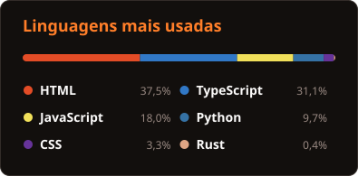

<picture><source media="(max-width: 600px)" srcset="./assets/perfil/hero-mobile.svg" /></picture>

  
  
  
  

### 🧠 Sobre Mim

<picture><source media="(max-width: 600px)" srcset="./assets/perfil/numeros-mobile.svg" /></picture>

- 🎓 **Bacharel em Ciência da Computação** pelo **Centro Universitário UDF** (2022–2025) — Láurea Acadêmica e nota 10 no TCC em Ciência de Dados e Machine Learning
- 🔍 **Aberto a vagas** de dados (análise e engenharia) e de desenvolvimento de sistemas orientados a dados
- 🚀 **Disponível para freelas** de sites, sistemas web, dashboards e automação — [andreruperto.dev](https://www.andreruperto.dev)

---

### 💼 Experiência

<picture><source media="(max-width: 600px)" srcset="./assets/perfil/experiencia-mobile.svg" /></picture>

- **Desenvolvedor FullStack Júnior** · Resende Mori Hutchison — sistema interno com mais de 30 módulos (React 18 + TypeScript, Node.js + Express, PostgreSQL, Airflow)
- **Desenvolvedor Web Freelancer** · Autônomo — sites e sistemas sob medida, do planejamento ao deploy
- **Analista de Dados Júnior** · Resende Mori Hutchison — pipelines em Python/pandas, dashboards em Power BI e Qlik
- **Estagiário, Equipe de Dados (COTIN)** · Ministério da Gestão e da Inovação (MGI) — scrapers, Power BI, documentação da API do Compras.gov.br

---

### 🚀 Projetos em Destaque

#### 01 / 🗳️ Turnos: Eleições 2026

Portal de jornalismo de dados sobre os dois turnos das eleições gerais de 2026, com cartograma por estado, hemiciclos do Congresso de 2027 e 596 perfis de candidatos.

- **Recursos:** mapa interativo por estado e município, cartograma, tabelas ordenáveis, hemiciclos por partido e espectro, análise entre os turnos, tema claro e escuro
- **Stack:** HTML, CSS e JavaScript no site; Python na coleta e no tratamento dos dados
- **Estado:** no ar, com os dois turnos publicados

[Site](https://1e2turnos.up.railway.app/) · [Código](https://github.com/AndreRuperto/turnos)

#### 02 / 🏥 Triagegeist

IA para triagem em pronto-socorro, que classifica o paciente de ESI 1 a 5 e explica cada previsão com SHAP. Na análise, identifiquei vazamento de dados na base do desafio Kaggle.

- **Recursos:** exploração dos dados, previsão interativa, notebooks e relatório, em português e inglês
- **Dados:** 100 mil pacientes sintéticos do desafio e a base real NHAMCS
- **Estado:** site no ar; código em repositório privado

[Site](https://triagegeist-kaggle.up.railway.app/) · [Desafio no Kaggle](https://www.kaggle.com/competitions/triagegeist/overview)

#### 03 / 📋 Modelo de Credenciamento — PNCP

Modelo de Machine Learning do meu TCC (nota 10) que separa os pedidos de credenciamento do PNCP que precisam de análise manual. Reduziria a fila de **1.494 para 97** pedidos (93,5% a menos), com acurácia de 94,65%.

- **Stack:** Python, Random Forest e XGBoost
- **Estado:** trabalho acadêmico concluído; não está em produção e não tem repositório público

<b>Mais projetos</b>

 

| Projeto | Descrição | Links |
|---|---|---|
| ⚽ **DataBola** | Análise estatística do Brasileirão Série A | [Site](https://databola.up.railway.app/) |
| 🧬 **Genética da Gravidez Explicada** | Site educativo com calculadora de risco, guias de alterações cromossômicas e fontes em cada número | [Site](https://genetica-na-gestacao.up.railway.app/) · [Código](https://github.com/AndreRuperto/genetica-na-gestacao) |
| 🌎 **Good Cities** | Compara qualidade e custo de vida em 99 cidades das Américas | [Site](https://good-cities.up.railway.app/) |
| 🔗 **Integração Alice × ComprasGov** | Pipelines com Airflow e Databricks entre o ComprasGov e o robô de auditoria Alice (CGU) | [Webinar](https://www.youtube.com/watch?v=234EGymqotI) |
| 👾 **Pac-Man Contributions** | Transforma o gráfico de contribuições do GitHub em um jogo de Pac-Man via GitHub Actions | [Código](https://github.com/AndreRuperto/svg-pacman-contributions) |
| 💸 **Controle Financeiro via WhatsApp** | Bot de despesas com categorização automática, parcelas e alertas de vencimento | [Código](https://github.com/AndreRuperto/whatsapp_gastos_ai) |

<a href="https://www.andreruperto.dev/#projects">Ver todos os projetos no portfólio →</a>

---

<!-- STATS:START -->
### 📊 Estatísticas

  
  

  

---
<!-- STATS:END -->

## 💻 Skills Técnicas:

### 🧑‍💻 &nbsp;Linguagens

### 🧠 &nbsp;Dados, Machine Learning & IA

  
  &nbsp;
  
  &nbsp;
  
  &nbsp;
  
  &nbsp;
  
  &nbsp;
  

XGBoost · LightGBM · SHAP · LLMs e RAG · EDA · modelagem de dados

### ⚙️ &nbsp;Engenharia de Dados, BI & Automação

  
  &nbsp;
  
  &nbsp;
  
  &nbsp;
  
  &nbsp;
  
  &nbsp;
  
  &nbsp;
  

Airflow (DAGs) · Power BI Embedded · Playwright · web scraping · APIs REST e GraphQL

### 🌐 &nbsp;Desenvolvimento Web

### 💾 &nbsp;Bancos de Dados

### 🛠️ &nbsp;Ferramentas & DevOps

 

  

